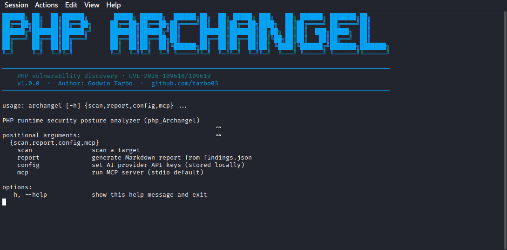
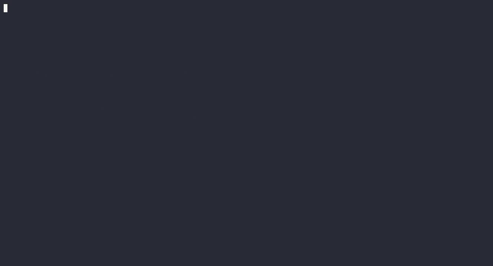
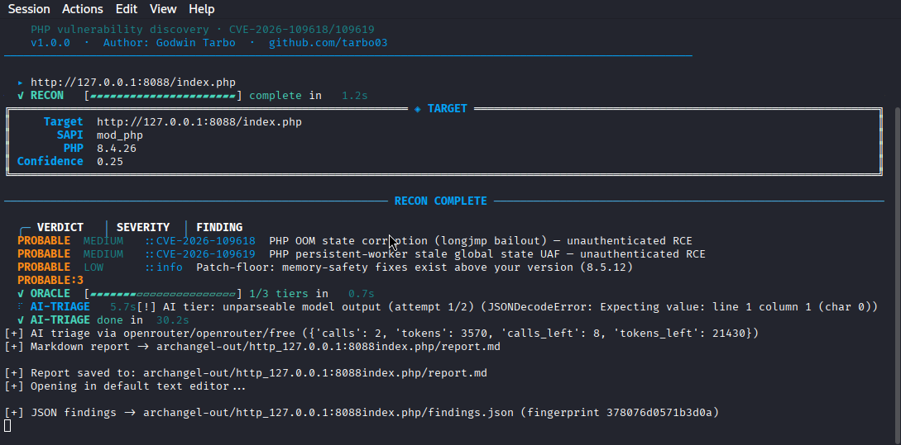
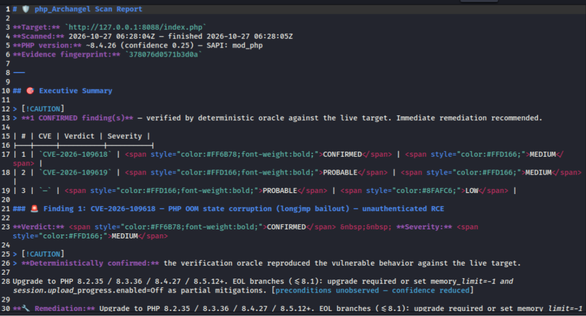

<div align="center">


**Evidence-Gated Verdicts · No Version Guessing**

**Evidence-driven PHP runtime security assessment**

*Discover potential php2shell-class exposure, validate findings through controlled checks, and produce auditable reports.*

[](https://www.python.org/downloads/)
[](LICENSE)
[](#responsible-use-and-safety)

**[Overview](#overview) · [Capabilities](#capabilities) · [Verification](#verification-model) · [Quick start](#quick-start) · [Usage](#usage) · [Safety](#responsible-use-and-safety)**

</div>


## Overview

**phpArchangel** is a Python-based security assessment tool focused on PHP runtime exposure and evidence-based vulnerability triage. Instead of treating a single version header as proof of exploitation, it combines multiple fingerprinting signals with optional behavioral checks and records why a finding was confirmed, considered likely, or dismissed.

Its verification philosophy is **Zero False Positives by Design**: an evidence-gated approach that avoids promoting version guesses into confirmed findings. This is a design objective, **not a mathematical guarantee**; infrastructure faults, WAF behavior, and timeouts can resemble vulnerability signals.

Its design follows the **SecPipe Doctrine**: preserve evidence, separate inference from observation, and make uncertainty explicit. The objective is to help authorized defenders prioritize remediation without presenting every weak signal as a proven vulnerability.

### Why it exists

Version banners can be absent, misleading, or affected by reverse proxies and configuration. Even when a version is known, a version match alone does not prove exploitability in a particular deployment. phpArchangel is designed to:

- Correlate multiple independent indicators of PHP runtime identity.
- Compare observed evidence with configured affected and fixed version ranges.
- Offer controlled verification where authorized and operationally appropriate.
- Preserve contradictory evidence and reasons for retraction.
- Generate reports suitable for technical review and remediation planning.

## Capabilities

| Area | Described functionality | Key consideration |
| --- | --- | --- |
| **Runtime discovery** | HTTP headers, PHP Easter-egg response signatures, exposed `composer.lock`, CMS/plugin age indicators, and JavaScript library clues | Some signals identify an application stack rather than the PHP runtime itself. |
| **Behavioral fingerprinting** | A set of PHP behavioral probes, including checks identified in the tool as `print_r_nan_warning` and `opcache_dce` | Behaviors may depend on configuration and extensions; treat results as supporting evidence. |
| **Patch-floor analysis** | Compares inferred versions with configured patch thresholds and tracks additional memory-safety concerns | Confirm advisory scope and affected branches for each issue. |
| **Behavioral verification** | Differential memory-pressure and connection-affinity checks for the described php2shell class | May disrupt services; run only with explicit authorization and suitable safeguards. |
| **AI-assisted triage** | Optional analysis of structured evidence using OpenRouter or NVIDIA Nemotron integrations, | AI output is advisory and cannot replace observed proof. |
| **Controlled proof-of-concept** | An opt-in, gated validation workflow described as *Angel-Sword* | Potentially destructive; disabled by default and reserved for isolated or expressly authorized environments. |
| **CLI experience** | Native ANSI styling, scan-phase indicators, interactive confirmations, and report output | Actual terminal behavior depends on version and environment. |
| **Reporting** | Markdown reports with evidence, verdicts, and supporting notes | Renderers differ in their support for inline HTML and GitHub-flavored alerts. |

## Verification model

phpArchangel uses **evidence-gated verdicts (no version guessing)**. The four general assessment states below describe the strength of the observed evidence; the more specific **`CONFIRMED VULNERABILITY`** and **`CONFIRMED RCE`** labels must never be conflated.

| Verdict | Interpretation | Recommended response |
| --- | --- | --- |
| **`CONFIRMED` / `CONFIRMED VULNERABILITY`** | A configured behavioral oracle has reproduced the expected vulnerable condition, with supporting observations. For the described OOM oracle, this means the vulnerable code path and a worker-failure/DoS condition were evidenced not that arbitrary code execution occurred. | Prioritize investigation and remediation; review evidence for confounding infrastructure behavior. |
| **`CONFIRMED RCE`** | Reserved for a separately verified **Angel-Sword** chain that actually demonstrates code execution, including the required memory-disclosure and control-flow-hijack steps. Especially where you feel that a crash, connection reset, or inferred instruction-pointer effect is insufficient. | Treat as a critical incident, preserve proof and assess impact. |
| **`PROBABLE`** | Version or behavioral signals suggest exposure, but deterministic confirmation is missing or inconclusive. | Validate configuration, advisories, and exposure before escalation. |
| **`RETRACTED`** | Subsequent evidence contradicts an earlier suspicion; the reason is retained. | Preserve the audit trail and reassess if evidence changes. |
| **`CLEAN`** | The tested exploit **precondition was not observed** under the assessed configuration and test conditions, or a separately verified fixed-version rule applies. A graceful response alone does **not** establish a patched binary. | Document scope and mitigations; verify the installed PHP build separately. |

> [!IMPORTANT]
> **Zero False Positives by Design** describes the verification philosophy, **not an absolute accuracy guarantee**. A WAF, proxy, network timeout, resource limit, or unrelated worker failure can mimic a crash signature. Correlate responses, repeat authorized checks where safe, and retain ambiguity rather than claiming certainty.
>
> **`CLEAN` does not necessarily mean patched.** If a roughly 130 MB oracle payload receives a graceful response, the tested out-of-memory bailout precondition was not demonstrated. The server may be patched **or** configured with a mitigation such as `memory_limit=-1`; a vulnerable binary can remain installed. This result cannot establish the PHP patch state by itself.
>
> **Worker crash ≠ RCE.** For the project-described **CVE-2026-109618** OOM state-corruption path, a reproducible oracle-triggered worker crash supports a DoS/vulnerable-code-path finding. Only independently demonstrated code execution via the gated **`angel_sword`** chain supports **`CONFIRMED RCE`**. The CVE designation and its technical mapping remain subject to official advisory verification.

### Assessment lifecycle

```text
Target supplied
      │
      ▼
Reconnaissance and evidence collection
      │
      ▼
Version reconciliation and patch-floor comparison
      │
      ▼
Preliminary verdict (with confidence and caveats)
      │
      ├── Safe checks only ───────────────► Report
      │
      ▼
Optional authorized behavioral verification
      │
      ▼
Evidence reconciliation and final verdict
      │
      ├── Optional structured AI triage
      │
      ▼
Markdown report and remediation review
```

## Detection and verification details

### Multi-signal runtime fingerprinting

The detection layer combines several possible evidence sources rather than trusting a single HTTP response header. Version information should be marked as **observed**, **inferred**, or **unknown**, with provenance retained in the report.

### Behavioral probes

This tool describes five PHP behavior probes intended to help distinguish vulnerable and fixed builds when `expose_php=Off`. These probes should be interpreted as version-related signals, not definitive proof of a particular build unless independently validated.

### Verification oracles

The tool describes two verification families:

- **Differential memory-pressure checks:** staged tests intended to distinguish failure modes under varying request characteristics.
- **Connection-affinity checks:** repeated-request observations intended to detect possible cross-request state anomalies.

These checks can cause resource exhaustion or worker disruption. A reproducible OOM-associated worker crash can support **`CONFIRMED VULNERABILITY`** for the tested DoS condition, but cannot alone support **`CONFIRMED RCE`**. A graceful response indicates only that the tested precondition was not observed; patching and configuration-level mitigation (including `memory_limit=-1`) remain distinct possibilities. WAF behavior and timeouts must be excluded as far as practicable. Do not run disruptive checks on production infrastructure without explicit approval and an agreed testing window.

### AI-assisted triage

Optional AI triage receives structured scan evidence rather than unrestricted target access. The tool describes a severity ceiling tied to deterministic evidence and a fallback to non-AI evaluation if model output cannot be parsed. AI recommendations should remain reviewable and clearly labeled as advisory.

### Angel-Sword validation workflow

The tool references an optional proof-of-concept path gated by verification and explicit operator consent. Because it may attempt code execution or disrupt worker processes, it must remain **opt-in** and should be used only in isolated labs or environments whose owners have explicitly authorized that testing. The README intentionally does not present exploitation as a prerequisite for routine exposure assessment. **`CONFIRMED RCE`** must be used only when the Angel-Sword chain actually demonstrates memory disclosure and instruction-pointer control culminating in code execution; a worker crash by itself is a **DoS/vulnerability** observation, not RCE.

## Requirements

- **Python 3.10 or later** .
- Network connectivity to systems you are authorized to assess.
- A terminal supporting ANSI colors for the intended visual experience.
- **Docker with Compose** only if you choose to build an isolated local test environment.
- Optional credentials/configuration for supported AI providers if AI triage is enabled.


## 📸 Screenshots

| Native CLI & Banner | Live Progress Bars |
| :---: | :---: |
|  |  |

| Oracle Verification | Colorized Markdown Report |
| :---: | :---: |
|  |  |

---

## Quick start

### Installation
```bash
git clone https://github.com/tarbo03/php_Archangel.git
cd php_Archangel
python3 -m venv venv
source venv/bin/activate
pip install -e .
```

### Initial Scan 
```bash
archangel scan https://target.com --no-interact
```
Use this mode for initial reconnaissance and evidence collection. The exact verification depth depends on the implemented defaults; inspect `archangel scan --help` before running it.
After installing the application and confirming the `archangel` executable is available:

```bash
archangel --help
```

### Verification (The OOM Oracle)
Fires the 3-Tier Oracle against PROBABLE findings to deterministically prove or retract the vulnerability. If the target is vulnerable, the worker may crash and auto-restart.

```bash
archangel scan https://example.org/index.php --auto-confirm
```

> [!WARNING]
>  Do not use it against live third-party systems without written permission and a documented test scope.

### High-impact validation

The `--auto-exploit` switch. Kindly note that this is **not recommended for routine scanning** and should be restricted to a controlled laboratory or an engagement that expressly authorizes code-execution testing. 

## Local laboratory guidance

For safe evaluation, use an **isolated Docker network** with intentionally vulnerable and patched PHP builds that have been independently verified against the relevant advisory for testing this tool. The tool proposes comparing `php:8.4.26-apache` and `php:8.4.27-apache`; **do not assume those images correspond to a verified vulnerable/patched pair without checking the official PHP release and security information.**

## Recommended lab controls:

1. Use disposable containers and non-sensitive test data.
2. Bind test services to loopback rather than exposing them publicly.
3. Set CPU, memory, and request limits appropriate for potentially disruptive tests.
4. Record the actual PHP runtime version and container image digest.
5. Test safe discovery first; run disruptive verification only in a dedicated environment.
6. Compare recorded evidence and verdicts, not merely exit codes or connection resets.

For upstream release and security information, consult the [PHP official website](https://www.php.net/) and [PHP supported versions](https://www.php.net/supported-versions.php).

## Reports and evidence

Markdown output intended for developer review and audit trails. A useful finding include:

| Field | Purpose |
| --- | --- |
| Target and timestamp | Identify the assessed endpoint and assessment window. |
| Issue identifier | Reference the relevant advisory or CVE, once verified. |
| Evidence sources | Show headers, signatures, configuration clues, or behavioral observations. |
| Runtime assessment | State the inferred or observed version and confidence. |
| Verification result | Describe what was tested and what was actually observed. |
| Verdict and rationale | Explain why a finding is confirmed, probable, retracted, or clean. |
| Limitations | Record skipped checks, timeouts, proxy uncertainty, or incomplete evidence. |
| Remediation | Recommend supported fixed versions and compensating controls where applicable. |

## Responsible use and safety

> [!CAUTION]
> **Authorized security testing only.** Some described verification and proof-of-concept functions may exhaust resources, terminate PHP workers, or attempt system-command execution. Obtain explicit written permission, define scope and testing windows, and establish rollback and incident contacts before enabling disruptive modes.

- Do not scan systems you do not own or have permission to test.
- Prefer non-disruptive reconnaissance for routine production assessment.
- Keep high-impact checks disabled unless explicitly requested and authorized.
- Treat scan outputs as sensitive operational data; avoid publishing secrets, session identifiers, or private endpoint details.
- Validate findings manually before making public vulnerability claims even though the tool is so promising.

## Troubleshooting

| Symptom | What to check |
| --- | --- |
| `archangel: command not found` | Confirm installation and the package's console-script entry point. |
| ANSI colors or progress indicators do not render | Check `TERM`, TrueColor support, and whether output is redirected or piped. |
| Version remains unknown | Confirm headers are visible; remember that proxies and `expose_php=Off` can hide evidence. |
| Connection resets during verification | Investigate resource limits, WAF/proxy interference, network faults, and worker restarts before interpreting the result. |
| AI triage is unavailable | Check provider credentials, connectivity, model selection, and deterministic fallback behavior. |
| Markdown report styling differs | Use a GitHub-flavored Markdown renderer; inline HTML support varies. |

## Contributing

Issues and pull requests are welcome once the repository's contribution process is published. Useful contributions include reproducible test cases, false-positive analyses, documentation improvements, and non-disruptive fingerprinting checks. Please avoid posting exploit payloads or sensitive production evidence in public issues.

For security-sensitive reports, use a private disclosure channel once the repository maintainer publishes one; do not disclose a live target's details in a public issue.

## License

The tool specifies the **MIT License**. See [LICENSE](LICENSE) for the complete terms once the license file is committed.

## Author

**Godwin Tarbo** - creator of phpArchangel.

---

<div align="center">

**phpArchangel** · *Evidence first. Defend with confidence.*

</div>
